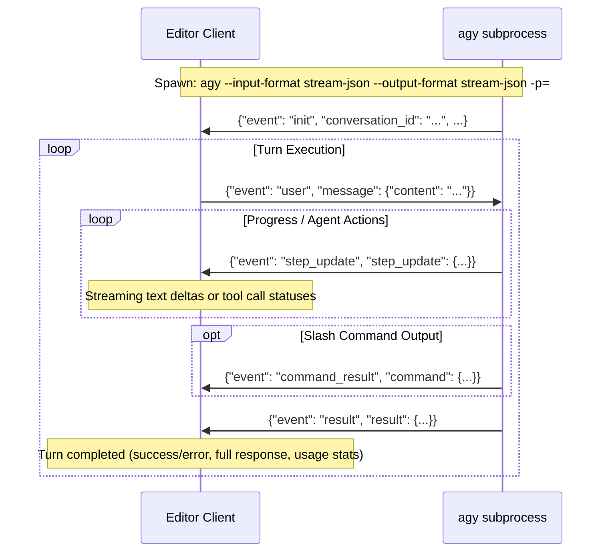

# Antigravity CLI (`agy`) Stream-JSON Protocol Specification

This document details the JSON communication protocol used by `agy` (Google Antigravity CLI) in persistent stream mode (`stream-json`), as implemented in the Emacs integration ([`~/.emacs.d/lisp/agy.el`](file:///Users/matthewsessions/.emacs.d/lisp/agy.el)).

---

## 1. Overview & Architecture

`agy` supports a continuous, multi-turn RPC session using newline-delimited JSON (NDJSON) over standard I/O pipes:
- **Transport**: Standard input (`stdin`) and standard output (`stdout`).
- **Encoding**: UTF-8, one valid JSON object per line terminated with `\n`.
- **Session Model**: A single long-running subprocess persists across multiple user prompts and model turns.



---

## 2. CLI Process Invocation

### 2.1 Spawning Persistent Stream Mode

To start a persistent session, spawn the `agy` binary with:

```bash
agy --input-format stream-json --output-format stream-json -p=
```

> **Note**: The empty `-p=` flag tells `agy` to enter print mode without an immediate initial prompt, preparing it to read subsequent turns from `stdin`.

### 2.2 Optional CLI Arguments

| Argument | Description | Example |
| :--- | :--- | :--- |
| `--model <id>` | Model identifier | `--model gemini-4-argon-medium` |
| `--effort <level>` | Reasoning effort (`low`, `medium`, `high`, `xhigh`, `max`) | `--effort high` |
| `--mode <mode>` | Execution mode (`auto`, `accept-edits`, `plan`) | `--mode accept-edits` |
| `--agent <name>` | Custom agent persona/definition | `--agent coder` |
| `--sandbox` | Run with sandbox and terminal restrictions enabled | `--sandbox` |
| `--conversation <uuid>` | Resume an existing conversation | `--conversation 200a702d-4eeb-48a8-bc50-2e6a5ffb3926` |
| `-c`, `--continue` | Resume the most recent conversation | `--continue` |
| `--add-dir <path>` | Add directory to workspace (repeatable) | `--add-dir /path/to/extra` |

The process working directory (`cwd`) must be set to the project root.

---

## 3. Client to `agy` Protocol (stdin)

The client sends messages as single-line JSON objects followed by `\n`.

### 3.1 User Message (`event: "user"`)

Sends a prompt to trigger a model turn.

```json
{
  "event": "user",
  "message": {
    "content": "Refactor src/ui/dock.zig to support vertical splits"
  }
}
```

#### Fields

| Field | Type | Description |
| :--- | :--- | :--- |
| `event` | `string` | Must be `"user"` |
| `message` | `object` | Message payload container |
| `message.content` | `string` | Prompt text (may include Markdown, code blocks, etc.) |

---

## 4. `agy` to Client Protocol (stdout)

`agy` sends newline-delimited JSON objects to `stdout`. Every message contains an `event` discriminator field.

### 4.1 Session Initialization (`event: "init"`)

Emitted immediately when `agy` starts up.

```json
{
  "event": "init",
  "conversation_id": "200a702d-4eeb-48a8-bc50-2e6a5ffb3926",
  "init": {
    "cwd": "/Users/matthewsessions/Projects/editor",
    "tools": [
      "run_command",
      "replace_file_content",
      "multi_replace_file_content",
      "view_file",
      "write_to_file",
      "grep_search",
      "find_by_name",
      "invoke_subagent"
    ],
    "permission_mode": "always-proceed"
  }
}
```

#### Fields

| Field | Type | Description |
| :--- | :--- | :--- |
| `event` | `string` | `"init"` |
| `conversation_id` | `string` | Assigned UUID for the conversation |
| `init.cwd` | `string` | Active workspace directory |
| `init.tools` | `string[]` | Array of available tool names |
| `init.permission_mode` | `string` | Active permission enforcement mode |

---

### 4.2 Incremental Step Updates (`event: "step_update"`)

Emitted repeatedly during a turn as the model streams response tokens, calls tools, or spawns subagents.

```json
{
  "event": "step_update",
  "step_update": {
    "conversation_id": "200a702d-4eeb-48a8-bc50-2e6a5ffb3926",
    "step_index": 3,
    "state": "RUNNING",
    "step_type": "agent_response",
    "text_delta": "Here is the proposed implementation:\n\n",
    "tool_name": null,
    "tool_info": null,
    "subagent_info": null,
    "usage": {
      "input_tokens": 1520,
      "output_tokens": 42,
      "thinking_tokens": 18,
      "cache_read_tokens": 1100,
      "total_tokens": 1580
    }
  }
}
```

#### Step Update Variants

#### A. Streaming Response Text (`step_type: "agent_response"`)
When `step_type` is `"agent_response"`, `text_delta` contains the next token chunk to append to the UI:
```json
{
  "event": "step_update",
  "step_update": {
    "step_type": "agent_response",
    "text_delta": "```zig\npub fn split() void {}\n```"
  }
}
```

#### B. Tool Invocations
When executing a tool, `step_update` contains `tool_name` and `tool_info`:
```json
{
  "event": "step_update",
  "step_update": {
    "step_index": 2,
    "step_type": "run_command",
    "tool_name": "run_command",
    "tool_info": {
      "tool_name": "run_command",
      "parameters": {
        "CommandLine": "zig build",
        "toolSummary": "Building editor application"
      }
    }
  }
}
```

The Emacs extension inspects `tool_info.parameters` in priority order to extract a human-readable summary label:
1. `toolSummary`
2. `toolAction`
3. `AbsolutePath`
4. `TargetFile`
5. `CommandLine`
6. `query`
7. `subagent_info.type_name`

#### C. Subagent Updates
When invoking an autonomous subagent:
```json
{
  "event": "step_update",
  "step_update": {
    "step_index": 5,
    "step_type": "subagent",
    "subagent_info": {
      "type_name": "research",
      "conversation_id": "7bf394e1-7e50-48e0-bb12-0750ba0b48c4"
    }
  }
}
```

---

### 4.3 Slash Command Results (`event: "command_result"`)

Emitted when a slash command executed within the stream produces output:

```json
{
  "event": "command_result",
  "command": {
    "name": "model",
    "data": {
      "selected": "gemini-4-argon-medium"
    }
  }
}
```

---

### 4.4 Turn Completion (`event: "result"`)

Emitted at the end of every turn. Indicates whether the turn succeeded or failed, and reports full metrics.

```json
{
  "event": "result",
  "result": {
    "conversation_id": "200a702d-4eeb-48a8-bc50-2e6a5ffb3926",
    "status": "SUCCESS",
    "response": "I have completed the changes to `src/ui/dock.zig`.",
    "error": null,
    "duration_seconds": 3.42,
    "usage": {
      "input_tokens": 2450,
      "output_tokens": 312,
      "thinking_tokens": 85,
      "cache_read_tokens": 1820,
      "total_tokens": 2847
    }
  }
}
```

#### Fields

| Field | Type | Description |
| :--- | :--- | :--- |
| `result.conversation_id` | `string` | Conversation UUID |
| `result.status` | `string` | Turn status (`"SUCCESS"`, `"ERROR"`, etc.) |
| `result.response` | `string` | Complete final markdown response text (fallback if `text_delta` was not streamed) |
| `result.error` | `string\|null`| Error message if turn failed |
| `result.duration_seconds` | `float` | Turn elapsed execution time |
| `result.usage` | `object` | Token accounting object |
| `result.usage.input_tokens` | `integer` | Raw input tokens |
| `result.usage.output_tokens` | `integer` | Output tokens generated |
| `result.usage.thinking_tokens` | `integer` | Reasoning / thinking tokens consumed |
| `result.usage.cache_read_tokens` | `integer` | Tokens retrieved from cache |
| `result.usage.total_tokens` | `integer` | Total cumulative tokens |

---

### 4.5 Diagnostic / Out-of-band Output

Any line on `stdout` or `stderr` that does **not** begin with `{`:
- If prefixed with `error:` (case-insensitive), it represents an unhandled CLI fatal error.
- Non-JSON lines should be displayed in the client's error/diagnostic log.

---

## 5. Session Control & Management

In the Emacs client (`agy.el`):

### 5.1 Interrupting a Turn
To cancel an active request:
1. Send `SIGTERM` / delete the running `agy` process.
2. Mark the active turn as aborted (`[Interrupted]`).
3. Next user action spawns a fresh process with `--conversation <conversation_id>` to preserve context.

### 5.2 Resetting a Conversation
To start fresh:
1. Kill the existing process.
2. Clear `conversation_id`.
3. Spawn a new process without `--conversation`.

### 5.3 One-Shot CLI Invocations
Certain queries are executed out-of-band without polluting the conversation history:
- **Model List**: `agy models` (returns tab-separated ID and descriptive name).
- **Usage / Quota**: `agy --output-format text -p=/usage`
- **Credits**: `agy --output-format text -p=/credits`
- **Skills**: `agy --output-format text -p=/skills`
- **Permissions**: `agy --output-format text -p=/permissions`
- **Hooks**: `agy --output-format text -p=/hooks`
- **Changelog**: `agy --output-format text -p=/changelog`

### 5.4 Interactive Terminal Handoff (TUI)
To switch seamlessly from embedded JSON mode into the full terminal interface:
```bash
agy --conversation <conversation_id>
```
Run inside an interactive pseudo-terminal (e.g. `vterm`).

---

## 6. Prompt Formatting Conventions

When sending contextual editor data into `agy` via `user` message `content`, the Emacs extension formats prompts using the following markdown conventions:

### Selected Code Region
```markdown
[Optional user instruction]

File: `src/ui/dock.zig` (lines 42-65):
```zig
pub const DockSlot = enum {
    left,
    right,
    bottom,
};
```
```

### Full File / Buffer Reference
```markdown
Review this file for potential memory leaks.

Target file: `src/platform/macos/metal_window.zig`
```

### Diagnostics / Compiler Errors
```markdown
Fix the following diagnostics in `src/ui/dock.zig`:
- Line 58: expected type 'u32', found 'i64'
- Line 74: unused local variable 'theme'
```
